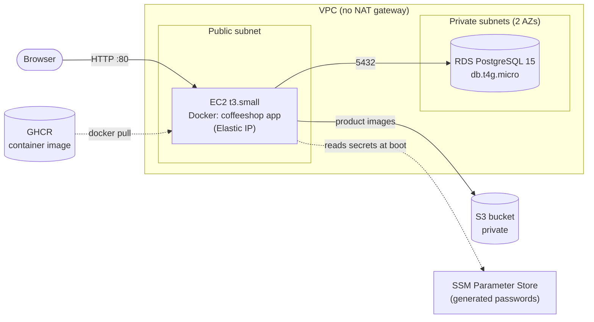

# Coffee Shop App

A coffee shop web application (Spring Boot, Thymeleaf, PostgreSQL) with a complete,
reproducible deployment to AWS using Terraform.

- Shop with categories, search, shopping cart and customer accounts (VIP discount)
- Admin area for products, manufacturers, suppliers, users and settings
- Product images stored in Amazon S3 (a local directory when running locally)
- HTTP sessions stored in the database, so the app does not depend on one server's memory
- Container image built and published by GitHub Actions
- Infrastructure as code: **one `terraform apply` creates everything, one `terraform destroy` removes it**

## Contents

- [Deploy to AWS with Terraform](#deploy-to-aws-with-terraform)
- [Run locally](#run-locally)
- [Configuration reference](#configuration-reference)
- [Development and CI](#development-and-ci)

---

## Deploy to AWS with Terraform

The deployment is meant for demonstrations: set it up, show it, destroy it. It runs in
your own AWS account and costs roughly **5 cents per hour** while it exists.

### What gets created



| Resource | Purpose |
|---|---|
| VPC, one public and two private subnets, internet gateway | Network. No NAT gateway, so no hourly NAT cost. |
| EC2 instance (Amazon Linux 2023, Docker) and Elastic IP | Runs the app container on port 80. |
| RDS PostgreSQL 15 (private, encrypted) | The database. Not reachable from the internet. |
| S3 bucket (private, all public access blocked) | Product images, accessed by the app through its IAM role. |
| SSM Parameter Store (SecureString) | Generated database password, admin password and cookie key. The server reads them at boot, they are never written into the instance's startup script. |
| IAM role and instance profile | Lets the server use S3 and read its own secrets, and enables SSM Session Manager. |
| Security groups | Only port 80 is open (optionally only to your IP). **No SSH.** Postgres accepts connections only from the web server. |

Everything is tagged `Project=coffeeshop` and named with a random suffix, so several
deployments can coexist in one account.

### Prerequisites

1. **An AWS account** and permission to create resources in it (see the next section).
   A separate sandbox account is a good idea.
2. **[Terraform](https://developer.hashicorp.com/terraform/install) 1.5 or newer.**
3. **[AWS CLI v2](https://docs.aws.amazon.com/cli/latest/userguide/getting-started-install.html)**,
   used to configure credentials and to check them.
4. *Optional:* the [Session Manager plugin](https://docs.aws.amazon.com/systems-manager/latest/userguide/session-manager-working-with-install-plugin.html)
   if you want a shell on the server (there is no SSH).

You do **not** need Docker, Java or Maven: the server pulls a prebuilt public image from the
GitHub Container Registry.

### Set up an AWS user for Terraform

Do not use the root account for this. Create a dedicated IAM user:

1. Sign in to the [AWS console](https://console.aws.amazon.com/) and open **IAM → Users → Create user**.
   Name it for example `terraform-coffeeshop`. It does not need console access.
2. **Set permissions → Attach policies directly → `AdministratorAccess`**, then create the user.
   Terraform creates IAM roles, so the user needs IAM rights as well as EC2, VPC, RDS, S3 and SSM.
   Admin access is the simple choice for a throwaway demo account; writing a narrower policy
   is possible but is not covered here.
3. Open the new user, **Security credentials → Create access key → Command Line Interface (CLI)**,
   and copy the access key ID and secret. The secret is shown only once.
4. Configure a named profile on your machine:

   ```bash
   aws configure --profile coffeeshop
   # AWS Access Key ID:     <paste>
   # AWS Secret Access Key: <paste>
   # Default region name:   eu-north-1
   # Default output format: json
   ```

5. Use that profile and **check which account you are in** before deploying anything:

   ```bash
   export AWS_PROFILE=coffeeshop
   aws sts get-caller-identity
   ```

   This prints the account ID and the user ARN. If it fails with `InvalidClientTokenId`,
   the key is wrong, deleted or expired; fix that first, because Terraform makes the same call.

> `export AWS_PROFILE=...` lasts only for the current terminal. Set it again in every new
> terminal, otherwise Terraform uses the `default` profile, which may be missing or point to
> another account.
>
> If your organisation uses AWS IAM Identity Center (SSO), run `aws configure sso` and
> `aws sso login --profile <name>` instead of creating access keys.
>
> When you are done with the demo, delete (or deactivate) the access key in the IAM console.

### Deploy

```bash
git clone https://github.com/esapuolakka/coffeeshop-java.git
cd coffeeshop-java/infra

export AWS_PROFILE=coffeeshop   # the profile from the previous step

terraform init
terraform apply
```

Terraform shows what it is going to create (about 30 resources). Type `yes` to continue.

- **Duration:** about 10 minutes. Most of it is the database.
- **After `apply` finishes**, the app needs another one to two minutes to start.

All settings have defaults, so nothing needs to be configured first. To change them, see
[Options](#options).

### Open the app

When `apply` completes, Terraform prints the outputs:

```
app_url        = "http://203.0.113.10"
health_url     = "http://203.0.113.10/actuator/health"
admin_username = "admin"
admin_password = <sensitive>
image_bucket   = "coffeeshop-1a2b3c-images"
shell_command  = "aws ssm start-session --region eu-north-1 --target i-0123456789abcdef0"
...
```

1. Wait until the health check answers `{"status":"UP"}`:

   ```bash
   curl "$(terraform output -raw health_url)"
   ```

2. Open `app_url` in a browser. Your browser will say the site is "not secure": the demo
   uses plain HTTP, see [Security notes](#security-notes).

3. **Get the admin password.** Terraform generates it and hides it in the normal output
   (`admin_password = <sensitive>`). Reveal it with:

   ```bash
   terraform output -raw admin_password
   ```

   Run this in the same `infra/` directory where you ran `apply`, because it reads the local
   state. Use `terraform output -raw` with the output's name: plain `terraform output` keeps
   showing `<sensitive>`. Log in at `<app_url>/login` with user `admin` and that password.

   If you ever lose the state, you can read the same password from AWS while the deployment
   exists (replace the path with `/coffeeshop-<suffix>/admin_password`; the suffix is the
   part of the `image_bucket` output between `coffeeshop-` and `-images`):

   ```bash
   aws ssm get-parameter --with-decryption --name /coffeeshop-1a2b3c/admin_password \
     --query Parameter.Value --output text
   ```

4. Try the S3 storage: in the admin area add a product with an image. The file appears in the
   bucket, and the app serves it from there:

   ```bash
   aws s3 ls "s3://$(terraform output -raw image_bucket)/images/"
   ```

### Options

Every variable is optional. Set them in a `terraform.tfvars` file (start from
`terraform.tfvars.example`) or on the command line with `-var`.

| Variable | Default | Description |
|---|---|---|
| `region` | `eu-north-1` | AWS region. The availability zone is chosen automatically to match the instance type. |
| `restrict_to_my_ip` | `false` | `true` allows only your current public IP to reach the app (detected when Terraform runs). |
| `allowed_cidrs` | `["0.0.0.0/0"]` | Networks allowed to reach port 80. Ignored when `restrict_to_my_ip` is true. |
| `app_image` | latest published image | Container image to run. Pin a version for reproducible demos, for example `ghcr.io/esapuolakka/coffeeshop-java:sha-<commit>`. |
| `instance_type` | `t3.small` | EC2 size. Graviton types such as `t4g.small` work too. |
| `db_instance_class` | `db.t4g.micro` | RDS size. |
| `db_allocated_storage` | `20` | RDS storage in GiB. |
| `db_engine_version` | `15` | PostgreSQL version. |
| `admin_username` | `admin` | Admin account name (the password is generated). |
| `name_prefix` | `coffeeshop` | Prefix for resource names (a random suffix is added). |
| `vpc_cidr` | `10.20.0.0/16` | VPC address range. |

Example:

```bash
terraform apply -var restrict_to_my_ip=true -var region=eu-west-1
```

### Shell access and logs

There is no SSH. Use AWS Systems Manager Session Manager (needs the plugin from the
prerequisites):

```bash
$(terraform output -raw shell_command)
sudo docker logs -f coffeeshop                 # application log
sudo cat /var/log/cloud-init-output.log        # first-boot script output
```

### Deploy a new version of the app

The server runs the image named by `app_image`.

- If you change `app_image` (for example to a new `sha-...` tag), the next `terraform apply`
  replaces the instance. The Elastic IP stays the same.
- If you keep using `latest`, Terraform cannot see that it changed. Force a fresh server with:

  ```bash
  terraform apply -replace=aws_instance.app
  ```

The database and the images are not affected by replacing the instance.

### Remove everything

```bash
terraform destroy
```

This takes several minutes and deletes everything, including the database and the images
(the bucket is emptied automatically, and the database is deleted without a final snapshot).
To confirm that nothing is left, and therefore nothing keeps costing money:

```bash
aws resourcegroupstaggingapi get-resources \
  --tag-filters Key=Project,Values=coffeeshop --region eu-north-1
```

The list should be empty (deleted resources can show up for a minute or two).

### Cost

Roughly **$0.05–0.06 per hour**, about $40 per month if you forget to destroy it. Approximate
breakdown in `eu-north-1`: EC2 `t3.small`, RDS `db.t4g.micro` plus storage, the EBS disk and the
public IPv4 address. S3 and SSM cost almost nothing at this size. Prices change, so check the
[AWS pricing pages](https://aws.amazon.com/pricing/) for current numbers.

### Troubleshooting

| Symptom | Cause and fix |
|---|---|
| `InvalidClientTokenId` or "security token included in the request is invalid" | The credentials Terraform picked up are wrong or expired. Run `aws sts get-caller-identity`. Make sure `AWS_PROFILE` is set in this terminal. |
| `AccessDenied` or `UnauthorizedOperation` | The IAM user lacks permissions. Use `AdministratorAccess` for the demo. |
| The health URL never answers | Open a shell (see above) and read `sudo docker logs coffeeshop` and `/var/log/cloud-init-output.log`. Wait a few minutes first: the first start takes 1–2 minutes after `apply`. |
| `docker pull` fails in `cloud-init-output.log` | The image is not public or does not exist. See [Using your own fork](#using-your-own-fork). |
| `apply` failed halfway | Run `terraform apply` again. It continues from where it stopped. |
| The browser warns the site is not secure | Expected: the demo uses HTTP only. |

### Using your own fork

The default `app_image` points to the image published from the original repository. If you
fork the repository, publish your own image:

1. Enable GitHub Actions on your fork and push to `master`. The *Build and publish image*
   workflow pushes `ghcr.io/<your-user>/<repo>` to the GitHub Container Registry.
2. On GitHub open your profile → **Packages** → the new package → **Package settings →
   Change visibility → Public**. New packages are private, and the server pulls without
   credentials.
3. Deploy with your image:

   ```bash
   terraform apply -var app_image=ghcr.io/<your-user>/<repo>:latest
   ```

### Security notes

- **Plain HTTP.** The demo has no domain name and no certificate, so passwords travel
  unencrypted. Do not reuse a real password, and consider `restrict_to_my_ip=true`.
- **The Terraform state contains secrets** (the generated passwords). It is stored locally in
  `infra/terraform.tfstate` and is git-ignored. Never commit it or share it, and do not commit
  your `terraform.tfvars`.
- **No SSH** and no key pair. Shell access goes through SSM and your IAM permissions.
- The database is private, encrypted, and reachable only from the web server.
- The admin password and the cookie signing key are generated per deployment.
- The server uses IMDSv2 only.
- This is a demonstration setup: one server, one database instance, no backups, no HTTPS.

---

## Run locally

### With Docker

Prerequisites: Docker Desktop (or Docker Engine) with the `docker compose` command.

```bash
docker compose up -d --build
```

This starts:

- `coffeeshop` app on port `8080`
- `db` PostgreSQL on port `5432`

Open `http://localhost:8080`. Login page: `http://localhost:8080/login`.

The admin user is created at startup. Locally the defaults are `admin` / `admin123`.
Override them (and the cookie key) with a `.env` file next to `docker-compose.yml`, which is
git-ignored:

```
APP_ADMIN_PASSWORD=choose-something
APP_REMEMBER_ME_KEY=choose-a-long-random-string
```

Product images are stored in the `uploads` Docker volume.

Useful commands:

```bash
docker compose down                       # stop
docker compose up -d --build coffeeshop   # rebuild after code changes
docker compose logs -f coffeeshop         # app logs
docker compose logs -f db                 # database logs
```

Reset the database and images (fresh seed data):

```bash
docker compose down -v
docker compose up -d --build
```

### Without Docker

Requires JDK 21. With no profile selected, the app uses an in-memory H2 database
(seeded from `src/main/resources/data.sql`) and stores images in `./uploads`:

```bash
./mvnw spring-boot:run
```

Defaults are for development only: admin `admin` / `admin123`, H2 console at `/h2-console`.

The `prod` profile (`-Dspring-boot.run.profiles=prod` or `SPRING_PROFILES_ACTIVE=prod`)
has no defaults for secrets and refuses to start without them, see below.

---

## Configuration reference

Environment variables read by the application (Spring maps them to properties):

| Variable | Used with | Description |
|---|---|---|
| `SPRING_PROFILES_ACTIVE` | | `prod` for deployments. Without it the app starts in development mode. |
| `SPRING_DATASOURCE_URL` | `prod` (required) | JDBC URL, for example `jdbc:postgresql://host:5432/coffeeshop`. |
| `SPRING_DATASOURCE_USERNAME` | `prod` (required) | Database user. |
| `SPRING_DATASOURCE_PASSWORD` | `prod` (required) | Database password. |
| `APP_ADMIN_USERNAME` | | Admin account name. Default `admin`. |
| `APP_ADMIN_PASSWORD` | `prod` (required) | Admin password. Development default is `admin123`. |
| `APP_REMEMBER_ME_KEY` | `prod` (required) | Secret used to sign "remember me" cookies. |
| `APP_STORAGE_TYPE` | | `local` (default) or `s3`. |
| `APP_STORAGE_LOCAL_DIR` | `local` | Image directory. Default `uploads`. |
| `APP_STORAGE_S3_BUCKET` | `s3` (required) | Bucket for product images. |
| `APP_STORAGE_S3_REGION` | `s3` | Bucket region. Defaults to `AWS_REGION` or the instance's region. |

AWS credentials for S3 come from the standard AWS provider chain. On EC2 that is the
instance role, so no keys are configured.

The health endpoint `GET /actuator/health` is public and is the only Actuator endpoint exposed.

---

## Development and CI

Run the application tests (JDK 21):

```bash
./mvnw verify
```

Test the Terraform without an AWS account (needs Terraform 1.7 or newer; providers are mocked):

```bash
cd infra
terraform init -backend=false
terraform test
```

The *Build and publish image* workflow (`.github/workflows/publish-image.yml`) runs on every
push and pull request:

1. application tests,
2. `terraform fmt`, `validate` and the offline Terraform tests,
3. builds the image, starts it and checks `/actuator/health` (a smoke test),
4. on pushes to `master` and `v*` tags, publishes a multi-architecture (amd64 and arm64) image to
   `ghcr.io/<owner>/<repo>` with the tags `latest` and `sha-<commit>` (and the version for tags).

The workflow needs no AWS credentials. Deploying is done with Terraform from your own machine.
